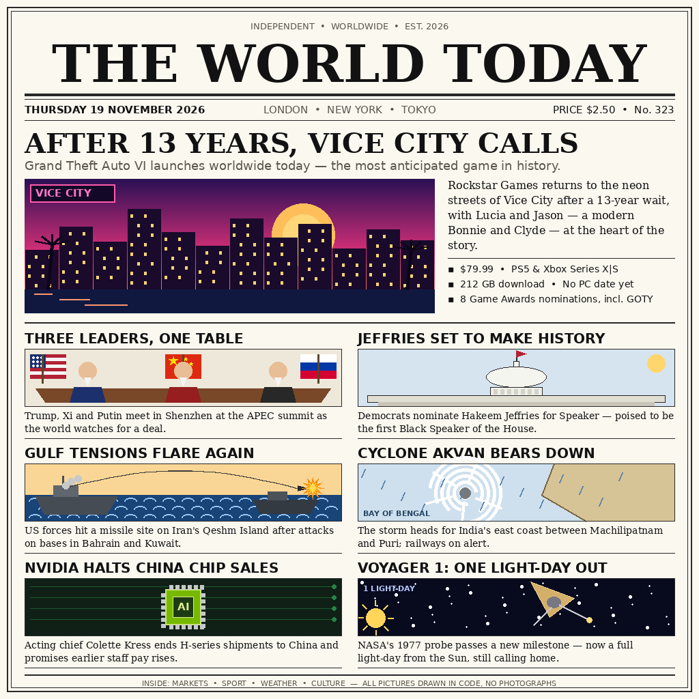

# THE WORLD TODAY — 19 November 2026

[](https://make.fun/bounty/news-image-20261119)
[](https://make.fun/bounty/news-image-20261119)
[](https://make.fun/bounty/news-image-20261119)

A newspaper front page summing up 19 November 2026's world news — drawn entirely in code. No photographs, no external images: every picture on the page (the Vice City skyline, the summit table, the Capitol dome, the Gulf, the cyclone, the chip, Voyager 1) is shapes and text rendered by Pillow.



## How it works

- `make_image.py` draws `entry.png` (1024 × 1024) deterministically with Pillow: masthead, dateline, a lead story on the GTA VI launch, and six picture stories, each with its own hand-coded illustration (gradient skies, skylines, flags, a spiral cyclone, a circuit-board chip, deep space).
- `main.py` is the competition entry point. It uses only the Python standard library and copies the repo's `entry.png` to `/output/entry.png` (creating `/output` if needed).
- Re-running `make_image.py` produces byte-identical output.

```bash
python3 make_image.py   # regenerate entry.png
python3 main.py         # copy entry.png to /output/entry.png
```

## Stories covered

| Story | Headline on the page |
|---|---|
| Grand Theft Auto VI launches worldwide after 13 years | AFTER 13 YEARS, VICE CITY CALLS |
| Trump, Xi and Putin meet at the APEC summit in Shenzhen | THREE LEADERS, ONE TABLE |
| Democrats nominate Hakeem Jeffries for US House Speaker | JEFFRIES SET TO MAKE HISTORY |
| US–Iran exchange fire; Gulf bases attacked | GULF TENSIONS FLARE AGAIN |
| Cyclone Akvan bears down on India's east coast | CYCLONE AKVAN BEARS DOWN |
| Nvidia halts H-series chip shipments to China | NVIDIA HALTS CHINA CHIP SALES |
| NASA's Voyager 1 passes one light-day from the Sun | VOYAGER 1: ONE LIGHT-DAY OUT |

## License

MIT — see [LICENSE](LICENSE).
